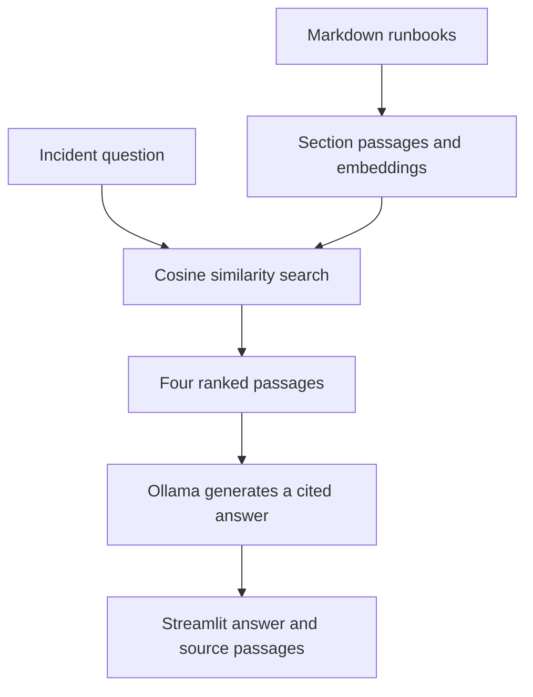

# Incident Navigator

A local RAG chatbot for diagnosing SFTP authentication failures and connection timeouts. It uses two fictional Markdown runbooks, Sentence Transformers for semantic search, NumPy for cosine similarity ranking, Ollama for generation, and Streamlit for chat and source inspection.

## Run on Windows

Install Python 3.12 and [Ollama](https://ollama.com/download). In PowerShell at the repository root, run:

```powershell
py -3.12 -m venv .venv
.\.venv\Scripts\python.exe -m pip install -r requirements.txt
ollama pull llama3.2:3b
.\.venv\Scripts\python.exe -m streamlit run .\src\app.py
```

Keep Ollama running and open the Local URL printed by Streamlit. The embedding model downloads on first use.

## Architecture



The embedding model is `sentence-transformers/all-MiniLM-L6-v2`. The app caches the index. Restart Streamlit after editing runbooks to rebuild it.

## Manual verification

| Scenario | Observed result |
|---|---|
| The server rejected my SSH key. What should I check? | Authentication diagnostics ranked first at 0.621. All three checks, including the fingerprint comparison, cited passage [1]. |
| The connection times out before login. How do I check whether the port is reachable? | Timeout diagnostics ranked fourth at 0.435. The answer used the documented PowerShell command and explained both TCP test outcomes. The citation appeared beside the hostname and port check. |

These two manual smoke tests cover the included SFTP scenarios. Similarity scores measure ranking. Model output can vary, so compare recommendations with the displayed evidence. Each question is processed independently. The app provides guidance and executes no remediation.
